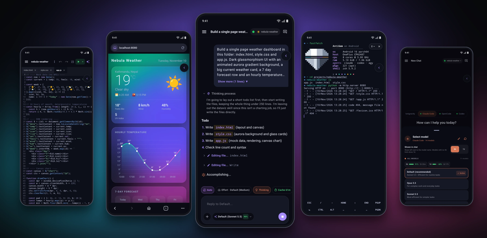

<div align="center">


# LytsoCoder

*A mobile AI coding workspace by @ItsLytso — carry a full Linux environment, editor, browser, and coding agents in your pocket.*

**An AI coding workspace for Android: Antigravity, Claude Code, OpenCode and Codex agents, a real Linux terminal, a code editor and a browser the agent can control, all in one app.**

[](https://developer.android.com/jetpack/compose)
[](https://go.dev)
[](LICENSE)
[](https://github.com/Lytso/LytsoCoder/releases)

[Download](https://github.com/Lytso/LytsoCoder/releases) · [Plugin SDK](extension_docs/README.md) · [User Guide](user_docs/README.md)

<br>



</div>

> [!IMPORTANT]
> ### LytsoCoder runs under its own package: `lytso.code`
> **LytsoCoder** uses its own package IDs (**`lytso.code`** for release, **`lytso.cdev`** for debug) and isolated local ports (**`1240/1241/8770`** release, **`1242/1243/8771`** debug), so it installs and runs side-by-side with **Termux** (`com.termux`) and **AntiGem** (`ai.antigem`) without conflicts.
>
> - **Byte-for-byte native Termux packages:** `lytso.code` and `lytso.cdev` are 10 characters long (just like `com.termux`), so Termux packages and binaries are relocated in place without proot and without slowdown.
> - **Migrating from AntiGem or Termux:**
>   1. In the old app: **Settings → Backups & Restore → Back up environment** (tick *Include SSH keys and sign-ins* if needed; never share that file).
>   2. Install **`LytsoCoder-v2.x.x.apk`** from [Releases](https://github.com/Lytso/LytsoCoder/releases).
>   3. On LytsoCoder's setup screen, choose **From a ZIP file** and pick your backup. Every `com.termux` path is rewritten for `lytso.code` while it restores.

---

## What it is

LytsoCoder runs four coding agents on your phone:

- **Antigravity (`agy`)**: Google's official `agy` CLI, installed with Google's own installer, runs inside the app's Linux environment.
- **Claude Code**: Anthropic's official `claude` CLI runs inside the app's Linux environment, and the app talks to it over its stream-json protocol, with one CLI process per chat.
- **OpenCode**: the open-source coding agent. It works with 200+ providers with your own keys, any OpenAI-compatible API, and free models.
- **Codex**: OpenAI's official `codex` CLI runs inside the app's Linux environment, and the app talks to it through its `app-server` protocol. Sign in with your ChatGPT account.

You can turn on any of the four agents, on first launch or later in **Settings → Agents**. An agent you turn off does not run.

**Use the models you want:** OpenCode connects to 200+ providers, including local models with Ollama or LM Studio, and Claude Code can run on OpenRouter, Kimi, DeepSeek, Z.ai (GLM) or any Anthropic-compatible API.

The app reads each agent's structured output, not its terminal text. That is how it shows streaming replies, tool approvals, the agent's questions, subagents and file changes as normal chat UI.

---

## Features

### Bring your own models: third-party providers
- **OpenCode (200+ providers)**: ChatGPT / OpenAI, GitHub Copilot, Claude subscription, SuperGrok / xAI, OpenCode Zen/Go, OpenRouter, Anthropic API, Ollama, LM Studio, vLLM, LiteLLM, or any custom OpenAI/Anthropic-compatible endpoint.
- **Claude Code**: One-tap presets for **OpenRouter, Kimi (Moonshot), DeepSeek and Z.ai (GLM)**, plus any Anthropic-compatible base URL and key.

### Agents, chat & voice
- Live streaming replies, collapsible thinking, tool cards, diffs and subagent progress.
- Tool approvals, plan approval and multiple-choice questions answered directly inside chat.
- Switch model, effort, thinking and permission mode mid-chat.
- Image/file attachments, voice dictation, audio playback, STEM/LaTeX/Mermaid rendering, and floating chat bubble.
- **Jarvis voice assistant**: hands-free control over the app, projects, tasks, approvals and subagents ([docs/jarvis.md](docs/jarvis.md)).

### Built-in MCP servers
Each preset can be enabled in **Settings → MCP Servers**:

| MCP | What the agent can do |
| :--- | :--- |
| **Browser** | Open, switch and close tabs, click/type on pages, run JavaScript, inspect the DOM, console logs, network and screenshots. |
| **Terminal** | Create terminal sessions, send commands, read output, kill processes, and change terminal theme/font. |
| **Android** | Read UI tree, tap, swipe, scroll, type, press keys, screenshots, launch/list apps, and ADB actions. |
| **Notes & To-dos** | List, read, create, edit and delete notes and to-do items. |
| **Custom Plugin / Plugin Developer** | Use or build custom browser/MCP plugins with JavaScript workers and Markdown skills. |
| **Jarvis** | Control the app, tasks, missions, timers, IDE and settings by voice or tool calls. |
| **Theme** | List, switch, create, edit, import and export color themes. |
| **REA** | Reverse engineering MCP (APK, Flutter, React Native, native libs) in an Ubuntu proot container. |

### Linux terminal, Code editor, Browser & Mini Apps
- **Linux terminal**: Full Termux-based Linux environment (`apt`/`pkg`, bash, Python, Node.js, Git, Go) running natively at full speed without proot. Includes **LytsoTerm** / **Termux** optional standalone launcher icon, **ADB Connect**, and **X11 Desktop** (XFCE/LXQt).
- **Code editor & Git**: Sora Editor with syntax highlighting, tabs, file explorer, diffs, commit/pull/push, and GitHub CLI integration.
- **In-app Browser & Mini Apps**: Dev preview browser with Eruda DevTools, plus sandboxed full-screen HTML/JS/CSS Mini Apps.
- **Connect to PC & Server mode**: Pair with a PC over Wi-Fi/SSH or run the bridge and agents on a remote Linux VPS ([docs/remote-server.md](docs/remote-server.md)).
- **Backups & Protection**: Back up/restore rootfs, projects and chats to `Download/LytsoCoder/backups`, plus uninstall shield and Clear Storage interceptor.

---

## Download & Termux Relocation

Get the latest APK from [Releases](https://github.com/Lytso/LytsoCoder/releases).

Termux packages are compiled for `/data/data/com.termux/files/usr`. Because `lytso.code` and `lytso.cdev` are 10 characters long (the exact byte length of `com.termux`), LytsoCoder rewrites `com.termux` byte-for-byte in file paths, scripts, symlinks and binaries during bootstrap/rootfs installation and automatically via an `apt` hook and `dpkg` wrapper. `am.apk` is compiled directly from `termux-am` for `lytso.code` / `lytso.cdev`.

---

## Building from source

**Requirements:** JDK 21+, Android SDK (Compile SDK 36) and Go 1.26+ for the bridge.

```bash
git clone --recursive https://github.com/Lytso/LytsoCoder.git
cd LytsoCoder

# Run Go bridge tests
cd agy_ide_bridge && go test ./... && cd ..

# Run Android unit tests and build Debug APK
./gradlew :app:testDebugUnitTest :app:assembleDebug

# Or package via helper script
./scripts/build_all_apks.sh
```

APKs are written to `app/build/outputs/apk/<buildType>/` and `output/`.

---

## Project structure

```text
LytsoCoder/
├── app/src/main/
│   ├── java/lytso/code/
│   │   ├── data/          # Agent backends (agy, claude, opencode, codex), terminal, ADB, automation, notes, updater
│   │   ├── domain/        # Chat models and parsing
│   │   └── ui/            # Compose screens: chat, IDE, browser, notes, settings
│   ├── java/com/termux/   # Termux terminal-view widget
│   ├── java/lytso/code/app/  # entry points the Termux tools call (termux-open, termux-wake-lock, …)
│   └── assets/browser-runtime/  # Extension host and Chrome API for plugins
├── agy_ide_bridge/        # Go bridge: agy hub, Claude Code relay, Git, plugins
├── extensions/            # Bundled plugins
├── extension_docs/        # Plugin SDK documentation and examples
├── scripts/               # Build, backup and restore scripts
└── version.json           # Version and changelog used by the in-app updater
```

---

## Privacy & Analytics

LytsoCoder has **no TelemetryDeck or third-party analytics SDK**. No install pings, session tracking, chats, prompts, code, or device identifiers are sent to any analytics service.

---

## Disclaimer

LytsoCoder is an independent project maintained by `@ItsLytso`. It is not affiliated with, endorsed by or sponsored by Google, Anthropic, OpenAI, OpenCode or any other AI provider. Antigravity, Claude, Claude Code, Codex and other product names are trademarks of their owners and are used here only to say which tools the app works with.

LytsoCoder is free software, provided as is, without warranty, as described in the [license](LICENSE).

## License & Attribution

Maintained by **@ItsLytso**. Forked from [Santoshkurmi/antigem](https://github.com/Santoshkurmi/antigem).
Copyright (C) 2026 Santosh Kurmi. Licensed under the [GNU General Public License v3.0](LICENSE) or any later version.
