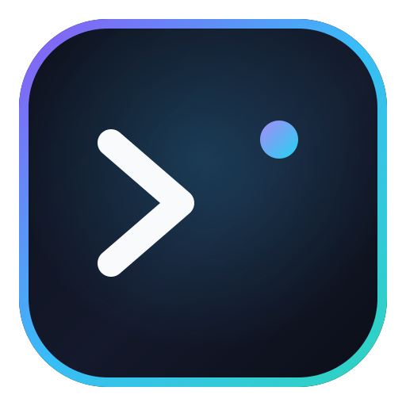

<div align="center">



# LytsoCoder

*An independent mobile AI coding workspace maintained by **@ItsLytso** — Linux terminal, code editor, controllable browser, and local agent orchestration for Android.*

[](https://developer.android.com/jetpack/compose)
[](https://go.dev)
[](https://developer.android.com)
[](LICENSE)
[](https://github.com/Lytso/LytsoCoder/releases)

[Releases](https://github.com/Lytso/LytsoCoder/releases) · [Plugin SDK](extension_docs/README.md) · [User Guide](user_docs/README.md) · [Legal & Copyright](#legal-licensing--copyright-compliance) · [NOTICE](NOTICE)

</div>

> [!IMPORTANT]
> ### Independent Package & Port Isolation (`lytso.code` / `lytso.cdev`)
> **LytsoCoder** runs under its own Android application IDs (**`lytso.code`** for release, **`lytso.cdev`** for debug) and isolated loopback ports (**`1240/1241/8770`** release, **`1242/1243/8771`** debug), allowing side-by-side installation alongside **Termux** (`com.termux`) or **AntiGem** (`ai.antigem`) without package or port collisions.
>
> - **Native Termux relocation:** `lytso.code` and `lytso.cdev` are 10 ASCII bytes (exact byte length of `com.termux`), allowing Termux binaries and paths to be relocated in place without proot overhead.
> - **Migrating from an existing backup:**
>   1. Export an environment backup from your previous app (**Settings → Backups & Restore → Back up environment**; keep backup files private).
>   2. Install **`LytsoCoder`** from [Releases](https://github.com/Lytso/LytsoCoder/releases).
>   3. Choose **From a ZIP file** during initial setup; `TermuxRelocation` automatically rewrites `com.termux` paths for `lytso.code` / `lytso.cdev`.

---

## Overview

LytsoCoder provides a unified local Android workspace—combining a Jetpack Compose chat interface, a Go bridge daemon (`agy_ide_bridge`), a native Termux-compatible Linux userland, Sora code editor, Git workflow, and an automation-ready WebView browser—designed to work with coding agent CLIs installed and authorized by the user inside their own environment:

- **Antigravity (`agy`)**: Connects via the local hub RPC interface when installed by the user.
- **Claude Code (`claude`)**: Talks to user-installed CLI processes over structured `stream-json` I/O (one managed session per chat).
- **OpenCode (`opencode`)**: Connects to open-source OpenCode (`opencode serve`) with 200+ custom or local providers (Ollama, LM Studio, vLLM, LiteLLM, OpenRouter, custom endpoints).
- **Codex (`codex`)**: Talks to the user's local Codex CLI `app-server` JSON-RPC interface.

You can enable or disable each agent independently during onboarding or in **Settings → Agents**. Disabled agents are never launched.

---

## Key Features

### Enhanced Conversation & Context Control
- **Editable Global Context & Per-Chat System Prompts**: Customize instructions injected into context globally and per conversation without locked boilerplate.
- **Non-Destructive In-Place Editing**: Edit both earlier user prompts and AI replies directly in place (inside local SQLite trajectory storage via `brainctl` or Claude JSONL transcripts) without truncating or resetting newer messages.
- **Thinking-Step Pruning**: Delete individual reasoning/thinking steps from conversation history and disk logs to break reasoning loops and reclaim context window space.
- **Obsolete Artifact Cleanup & Context Redaction**: Delete outdated artifacts from disk while redacting their heavy payloads inside SQLite/transcript history so the model stops re-reading discarded drafts.
- **Fork / Branch Anywhere**: Branch a new independent conversation from any historical message—old or recent—while preserving the original thread intact.
- **Zero-Disconnect Brain Sync**: `agy_ide_bridge` pauses the hub cleanly on Android 11+ using `syscall.Kill` (`pkg/procutil`, avoiding blocked `pidfd_send_signal` seccomp calls), rotates CSRF tokens automatically, and reloads the live trajectory stream without dropping the app connection.

### Agents, Voice & BYO Providers
- Live streaming replies, collapsible thinking blocks, inline diffs, subagent tracking, tool approvals, plan approvals, and structured multiple-choice questions (`ask_question`).
- Mid-chat switching for model, reasoning effort, thinking budget, and permission mode.
- **OpenCode & Claude Code BYO Endpoints**: Presets and custom base URLs for OpenRouter, Moonshot/Kimi, DeepSeek, Z.ai (GLM), Ollama, LM Studio, or any OpenAI/Anthropic-compatible server.
- **Multi-Account AGY Switcher & Live Watcher**: Manage and switch multiple saved `agy` accounts cleanly without restarting the app.
- **Elephant-Goldfish Method (`EGM`) & Gemmy**: Built-in `/egm`, `/egm-lite`, and `/egm-review` adversarial planning workflows, pinned chats drawer section, and optional **Gemmy** floating companion.
- **Rainbow AMOLED Special Theme & Minimalist Neon `>_` Emblem**: True `#000000` AMOLED surfaces with prismatic Neon Rainbow accents (`Settings → Themes`) matching the app and README icon.
- Image/file attachments, voice dictation, STEM/LaTeX/Mermaid/TikZJax rendering, floating bubble, and **Jarvis** hands-free control ([docs/jarvis.md](docs/jarvis.md)).

### Built-in MCP Servers
Toggleable per preset in **Settings → MCP Servers**:

| MCP Server | Capabilities |
| :--- | :--- |
| **Browser** | Tab management, DOM inspection, JS evaluation, console/network capture, screenshots, page interactions. |
| **Terminal** | Multi-session shell management, command dispatch, output reading, process control, theme customization. |
| **Android** | Accessibility/UI tree inspection, input actions, screenshots, app management, ADB integration. |
| **Notes & To-dos** | Local notes and task-list persistence across sessions. |
| **Custom Plugins** | JS worker + Markdown skill SDK for user-authored browser/MCP extensions ([extension_docs](extension_docs/README.md)). |
| **Jarvis** | Task, timer, mission, project, and IDE orchestration via tool calls or voice. |
| **Theme** | Color scheme switching, creation, import, and export. |
| **REA** | Isolated Ubuntu proot environment for mobile binary/app inspection tasks. |

### Terminal, Editor, Browser & Server Mode
- **Linux Environment (`aarch64` & `x86_64`)**: Native Termux-based shell (`apt`/`pkg`, bash, zsh, Python, Node.js, Git, Go) without proot slowdown, per-ABI glibc runtime (with `x86_64` seccomp syscall shim), optional standalone terminal launcher, **ADB Connect**, and **X11 Desktop** support.
- **Code Editor & Git**: Sora Editor with TextMate grammars, multi-tab workspace, file tree, diff viewer, and Git/GitHub CLI tooling.
- **Browser & Mini Apps**: Embedded preview browser with DevTools and sandboxed HTML/JS/CSS Mini Apps.
- **Remote PC / VPS Mode**: Connect over SSH/Wi-Fi or run `agy_ide_bridge` on an external Linux host ([docs/remote-server.md](docs/remote-server.md)).
- **Backups & Data Protection**: Export/restore rootfs, projects, and chats (`Download/LytsoCoder/backups`).

---

## Building from Source

**Requirements:** JDK 21+, Android SDK (Compile SDK 37.1, NDK), and Go 1.26+.

```bash
git clone --recursive https://github.com/Lytso/LytsoCoder.git
cd LytsoCoder

# 1. Sync bridge version metadata and run Go bridge unit tests (seccomp-safe procutil, brainctl, hub pause/restart)
cp version.json agy_ide_bridge/pkg/buildinfo/version.json
cd agy_ide_bridge && go test ./... && cd ..

# 2. Run Android unit tests and compile Debug APKs (includes embedded Go bridge binary)
./gradlew :app:testDebugUnitTest :app:assembleDebug
# Optional x86_64 build:
./gradlew :app:assembleDebug -Pabi=x86_64

# 3. Package APK artifacts into output/ (add --x86_64 to include x86_64 APKs)
./scripts/build_all_apks.sh --x86_64
```

To build reproducible `rootfs-v2` or offline STEM `render-v1` archives independently from upstream open manifests:
- Rootfs builder: `python3 scripts/build_rootfs.py --package lytso.code --output output/lytsocoder-rootfs-aarch64.zip`
- Render bundle builder: `bash scripts/render_bundle/build_render_bundle.sh`

---

## Project Structure

```text
LytsoCoder/
├── app/src/main/
│   ├── java/lytso/code/
│   │   ├── data/                # Agent backends (agy, claude, opencode, codex), backups, remote bridge/hub clients
│   │   ├── domain/              # Chat models, TrajectoryEngine, STEM/timeline parsing
│   │   └── ui/                  # Jetpack Compose UI: chat, IDE, browser, notes, settings
│   ├── java/com/termux/         # Termux terminal-view integration
│   ├── java/lytso/code/app/     # Termux intent/API entry points for lytso.code / lytso.cdev
│   └── assets/browser-runtime/  # Extension host & runtime APIs
├── agy_ide_bridge/
│   ├── main.go                  # Local Go bridge HTTP/WebSocket server & hub supervisor
│   └── pkg/
│       ├── brainctl/            # Direct SQLite protobuf & transcript editor (in-place edits, pruning, redaction)
│       ├── procutil/            # Android 11+ seccomp-safe signal/process helpers (syscall.Kill)
│       ├── hub/, claude/, codex/, opencode/, checkpoint/, memory/, plugins/, security/, ws/
├── extensions/                  # Bundled open-source browser/MCP extensions
├── extension_docs/              # Plugin SDK documentation
├── user_docs/                   # User guide documentation
├── scripts/                     # APK build, backup/restore, rootfs, and STEM bundle builders
├── LICENSE                      # Full GNU GPL v3.0 license text
├── NOTICE                       # Copyright provenance, dated changelog of modifications & third-party notices
└── version.json                 # Version metadata for the built-in updater
```

---

## Privacy & Zero Telemetry

LytsoCoder contains **zero TelemetryDeck or third-party analytics SDKs**. The app does not send install pings, usage telemetry, chat transcripts, prompts, source code, or device identifiers to analytics servers. Network connections go only to endpoints you configure (local loopback bridge, your remote server, GitHub, or your selected AI/API providers).

---

## Legal, Licensing & Copyright Compliance

### 1. Open-Source License (GNU GPL v3.0 or later)
LytsoCoder is free software released under the terms of the **GNU General Public License, Version 3.0, or (at your option) any later version** ([GPL-3.0-or-later](LICENSE)). Full license text is located in [LICENSE](LICENSE), and detailed component attributions are recorded in [NOTICE](NOTICE).

### 2. Upstream Provenance & Modification Notice (GPLv3 §§ 4 & 5)
In strict compliance with GNU GPLv3 Sections 4 and 5:
- **Upstream Work:** LytsoCoder is a modified derivative fork of [`Santoshkurmi/antigem`](https://github.com/Santoshkurmi/antigem) (synchronized up to `c9981af` on `standalone`).
- **Preserved Upstream Copyright:** `Copyright (C) 2026 Santosh Kurmi` — Licensed under GNU GPL v3.0 or later.
- **Modifications Notice:** Original additions and modifications are `Copyright (C) 2026 @ItsLytso` (likewise licensed under GNU GPL v3.0 or later), dated **2026-11-20** in [NOTICE](NOTICE) and recorded in commit history (`lytso.code` rebrand & isolation, telemetry removal, independent rootfs/render asset builders, Enhanced Conversation & Context Control, Android 11+ seccomp-BPF compatibility fixes, and original Neon Rainbow LytsoCoder emblem/launcher artwork).

### 3. Corresponding Source Availability (GPLv3 § 6)
The complete corresponding source code for LytsoCoder (Android application, Go bridge, submodules, and build scripts) is publicly hosted at [`https://github.com/Lytso/LytsoCoder`](https://github.com/Lytso/LytsoCoder). Source code for upstream Termux userland packages referenced by the optional rootfs builder is maintained by Termux at [`https://github.com/termux/termux-packages`](https://github.com/termux/termux-packages).

### 4. Trademarks & Non-Affiliation Disclaimer (Nominative Use)
**LytsoCoder** and **@ItsLytso** are completely independent and are **not** affiliated with, endorsed by, sponsored by, or officially connected with Google LLC, Anthropic PBC, OpenAI, L.L.C., OpenCode, the Termux Project, or upstream maintainers.

All product names, service names, CLI identifiers, and trademarks—including **Android**, **Antigravity (`agy`)**, **Claude**, **Claude Code**, **OpenAI**, **Codex**, **ChatGPT**, **OpenCode**, **GitHub**, and **Termux**—remain the exclusive property of their respective owners and are used here strictly under **nominative fair use** to describe technical compatibility and supported workflows.

### 5. Third-Party Software, APIs & User Responsibility
- **No bundled proprietary models or credentials:** This Git repository and the compiled APK do not contain proprietary LLM weights, third-party API keys, paid subscriptions, or DRM/access circumvention tools.
- **User-supplied tools & compliance:** Users independently obtain, authenticate, and operate third-party CLIs, accounts, and API endpoints at their own discretion and are solely responsible for complying with each provider's Terms of Service, usage limits, and applicable software licenses.
- **Optional release archives:** Any optional environment archives published under Releases (such as `rootfs-v2` or `render-v1`) are convenience packages built via the transparent scripts in `scripts/` directly from public upstream repositories/manifests and do not grant any proprietary license outside upstream terms.

### 6. Disclaimer of Warranty & Limitation of Liability (GPLv3 §§ 15–16)
THIS SOFTWARE IS PROVIDED **"AS IS"**, WITHOUT WARRANTY OF ANY KIND, EXPRESS OR IMPLIED, INCLUDING BUT NOT LIMITED TO THE WARRANTIES OF MERCHANTABILITY, FITNESS FOR A PARTICULAR PURPOSE, AND NONINFRINGEMENT. IN NO EVENT SHALL THE AUTHORS, MAINTAINERS, OR COPYRIGHT HOLDERS BE LIABLE FOR ANY CLAIM, DAMAGES, DATA LOSS, ACCOUNT ACTION, OR OTHER LIABILITY ARISING FROM THE USE OF THIS SOFTWARE OR THIRD-PARTY TOOLS.

### 7. Good-Faith Copyright, Trademark & Removal Contact
We respect the intellectual property and licensing rights of all creators and organizations. If you are a copyright owner, trademark holder, or upstream contributor and believe that any source file, asset, attribution line, or GitHub release archive in this repository raises a legal or licensing concern, please open an issue at [`https://github.com/Lytso/LytsoCoder/issues`](https://github.com/Lytso/LytsoCoder/issues) with details for prompt, good-faith review, correction, or removal.
